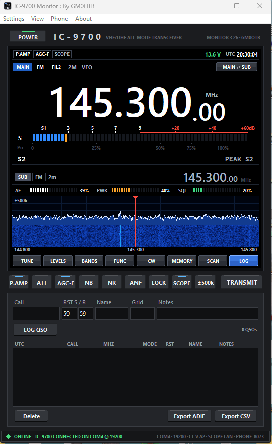
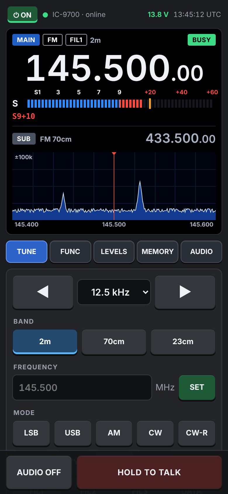
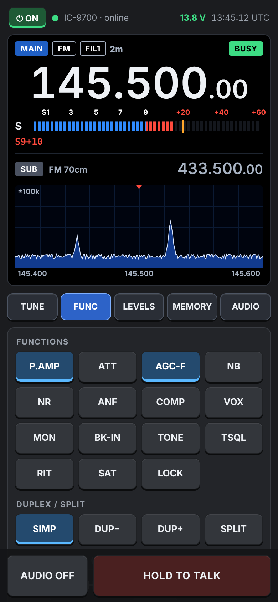
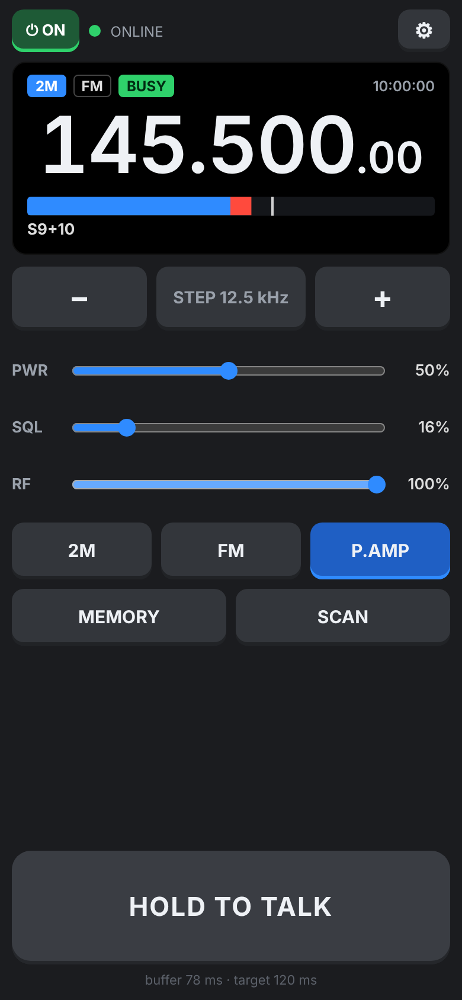
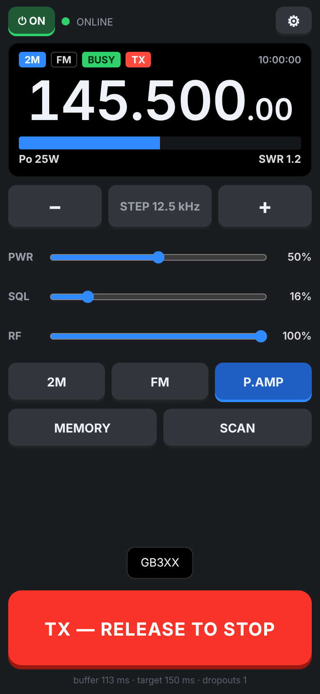

# IC9700 Monitor

**A Windows control panel for the Icom IC-9700, with remote operation from your phone.** By GM0OTB.

IC9700 Monitor talks to the radio over its USB cable (CI-V), shows a display modelled on the radio's own screen, and serves a password-protected web page so you can listen, talk, tune and switch the radio on and off from a phone anywhere, over Tailscale.



## What's in this repository

| Part | What it is | Docs |
| --- | --- | --- |
| **IC9700 Monitor** (`IC9700.py`) | The Windows program: display, meters, scope and waterfall, all controls, memories, scanner, QSO log | [Desktop app](docs/desktop-app.md) |
| **Scope over Ethernet** | The spectrum scope from the radio's LAN port while everything else stays on USB | [Scope over LAN](docs/scope-over-lan.md) |
| **Phone page** | Full remote control in the phone's browser: display, scope, all controls, audio both ways | [Phone page](docs/phone-page.md) |
| **Lite phone page** | A minimal page built for clear audio and quick PTT | [Lite page](docs/lite-page.md) |
| **Android apps** | *IC-9700* (full page) and *IC-9700 Lite* as installable apps | [Android apps](docs/android-apps.md) |
| **Mac app** | IC9700 Monitor for the Mac (Apple silicon or Intel): `.dmg` on the Releases page, or `build_mac.sh` | [Mac app](docs/mac.md) |
| **Windows installer** | Builds a normal setup `.exe` so the program runs without Python | [Windows installer](docs/windows-installer.md) |
| **Connector X-Ref** | A separate offline Android app: circular connector part-number decoder and cross-reference | [Connector X-Ref](docs/connector-xref.md) |

Also: [Troubleshooting](docs/troubleshooting.md) · [CI-V commands used](docs/ci-v-reference.md) · [Changelog](CHANGELOG.md)

## Features

- **Display like the radio's:** large frequency readout (mouse wheel over a digit tunes that digit), MAIN and SUB bands, S-meter blue to S9 and red above, TX meter with Po, SWR, ALC, COMP and Id.
- **Spectrum scope and waterfall:** click or drag to tune, SPAN key from ±2.5 kHz to ±500 kHz, tuned frequency always in the centre. Optional fast scope over Ethernet.
- **All the everyday controls:** modes and filters, 15 level sliders, preamp, attenuator, AGC, NB, NR, notch, split, duplex, CTCSS, satellite mode, RIT, CW keyer with macros.
- **CW decoder** on the radio's receive audio: finds the tone and follows the speed by itself, with a sensitivity setting; text on the PC and the phone.
- **Power on/off** from the PC or the phone over CI-V.
- **Memories** read from the radio, CSV import/export, scanner with a band-activity plot.
- **QSO log** with dupe check, ADIF and CSV export.
- **Phone access** over Tailscale with HTTPS: hear the radio on the phone, talk through it, see the scope, tune, change everything.
- **Lite phone page and app** with an adaptive audio buffer, direct-to-radio PTT and the phone's call processing switched off.

<p>




</p>

*Full phone page (left two) and the lite page (right two). Phone images show sample radio data.*

## Quick start

1. **Radio:** MENU > SET > Connectors > CI-V: CI-V USB Baud Rate 19200 or 115200, CI-V Address A2, CI-V Transceive ON.
2. **PC:** install Python 3 from [python.org](https://www.python.org/downloads/), then in a command prompt:
   ```
   py -m pip install pyserial sounddevice
   ```
3. Plug in the USB cable and run `IC9700.py` (double-click it, or `py IC9700.py`).
4. **Settings > Settings…**: choose the COM port (or Auto), the radio's baud rate, address A2 and your callsign, then **Save & connect**.

To install it like a normal Windows program instead, see [Windows installer](docs/windows-installer.md).

## Requirements

| | Needed |
| --- | --- |
| Radio | Icom IC-9700, USB cable (Icom USB driver if Windows shows no COM port) |
| PC | Windows 10 or 11 with Python 3.10 or later, or the built installer |
| Python packages | `pyserial`; `sounddevice` only for phone audio |
| Phone access | [Tailscale](https://tailscale.com/) on the PC and phone, for HTTPS and use away from home |
| Scope over Ethernet | Radio on your network with Network Control on |

## Files the program keeps

Settings, the QSO log and the HTTPS certificate are saved next to `IC9700.py`, or in `%LOCALAPPDATA%\IC9700 Monitor` for the installed program. They are personal and are listed in `.gitignore`, so they never go into this repository.

## Licence

No licence has been chosen yet, so the usual copyright rules apply: you may look at and download the code, but not reuse or redistribute it without permission from the author.
