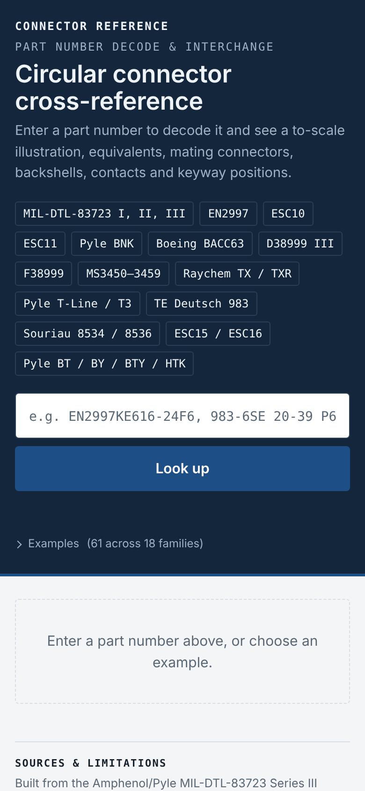

# Connector X-Ref

A separate, offline Android app for circular connectors: type a part number to decode it and see a to-scale illustration, equivalents, mating connectors, backshells, contacts and keyway positions. It covers MIL-DTL-83723, EN2997, ESC10/11/15/16, Pyle, Boeing BACC63, D38999, MS3450-3459, Raychem TX/TXR, TE Deutsch 983, Souriau 8534/8536 and more.



The page itself is `connector-xref/Connector Cross-Reference.html`, which also works in any browser.

## Building the app

1. Keep `build_connector_apk.bat`, `build_html_apk.py` and `build_apk.py` in this repository's folder, with the page in `connector-xref\`.
2. Double-click `build_connector_apk.bat`.
3. The result is `connector-xref\Connector_X-Ref.apk`. Install it as described in [Android apps](android-apps.md).

For your own icon, put `Connector Cross-Reference.png` next to the page before building.

## What the app adds to the page

- **Works offline:** the page is packed inside the app. The IBM Plex web fonts load when online; otherwise the page's fallback fonts are used.
- **Printing:** the section **Print** and **Print all** buttons open Android's print dialog, which also offers **Save as PDF**.
- **Recent searches** are kept between uses.
- **Light or dark** follows the phone's setting (Android 10 and later).

## Making other pages into apps

`build_html_apk.py` works for any single HTML page:

```
py build_html_apk.py "My Page.html" "My App"
```

It creates `My_App.apk` next to the page, with its own app ID, so each page installs as a separate app.
