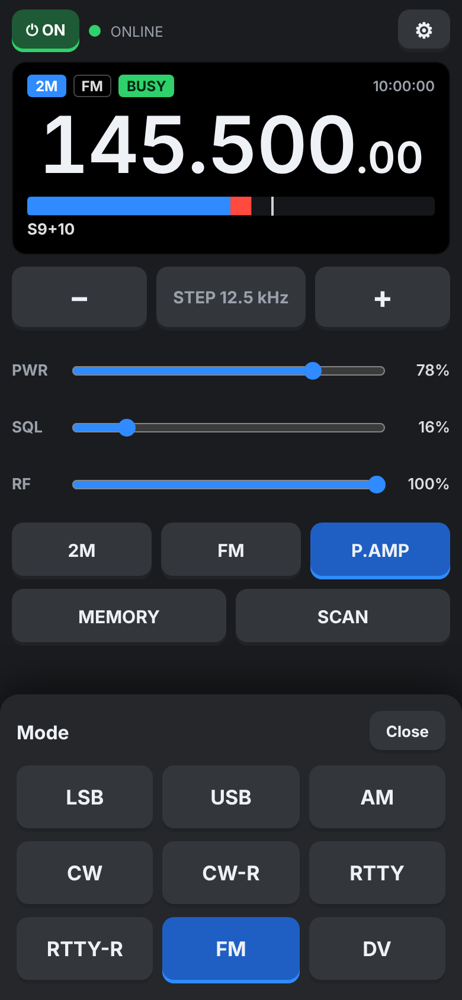

# Lite phone page

A minimal phone page built for **clear audio and quick PTT**. Open your usual https address with `lite` on the end, for example `https://your-pc.tailnet-name.ts.net:8074/lite`, or use **Phone > Open the LITE phone page** on the PC. The [IC-9700 Lite app](android-apps.md) opens it directly.

## Starting

Tap **TAP TO START AUDIO** once. This starts the speaker and opens the microphone together, so PTT doesn't have to wait for the microphone later. The screen is kept on while the page is open.

## Controls

| Control | Use |
| --- | --- |
| ⏻ ON / OFF | Switch the radio on or off (off asks first) |
| Frequency | Tap to type one on the keypad, e.g. `145.5` or `433500`; **−** / **+** step it; **STEP** chooses the step |
| BAND | 2M, 70CM, 23CM (each returns to the last frequency used) |
| MODE | LSB, USB, AM, CW, CW-R, RTTY, RTTY-R, FM, DV |
| Meter | S-meter on receive, blue to S9 and red above; Po and SWR on transmit |
| PWR | RF power |
| SQL | Squelch |
| RF | RF gain |
| P.AMP | Preamp |
| MEMORY | List of memory channels: tap to recall |
| SCAN | Scans the memory channels, stopping on signals |
| HOLD TO TALK | PTT (or tap on / tap off, in ⚙ settings) |
| ⚙ | Phone volume, mic gain, PTT mode, TX tone, mic level, voice processing status |

You can also tap the band and mode tags on the display.

## Why the audio is clearer

- **One connection** carries audio, display and commands, so there are no extra web requests competing with the audio.
- **Playback runs in its own audio thread** on the phone (an AudioWorklet), so screen updates can't break it up.
- **Adaptive jitter buffer:** playback starts with 120 ms of audio held in hand. After a dropout it holds more (up to 400 ms); after 10 s without one it shrinks back (down to 80 ms). The grey line under PTT shows the buffer and counts any dropouts.
- **Phone voice processing is off:** echo cancelling, noise suppression, auto gain and voice isolation are made for phone calls and make a radio mic sound pumped and muffled. The page turns them off, applies that again to the live microphone, then reads back what the phone actually did. ⚙ shows the result in green, or amber if a phone refused.
- **The PC puts the phone first:** while a phone is listening, the PC's scope redraws less often.

## Why PTT is quicker

- The microphone is already open, so pressing doesn't wait for it.
- The PC keys the radio straight from the phone's connection, without waiting in the program's command queue.
- The radio's audio input is opened before keying and kept open between overs, so the first word isn't clipped.
- On release, the last words still in the buffer are played out before the radio unkeys.

## Microphone audio path

The phone's microphone is low-pass filtered at 7 kHz, resampled to 16 kHz, shaped by the TX tone setting (Full, Clear or Crisp), converted to 8-bit µ-law and sent in 20 ms packets. Receive audio comes the other way as 16 kHz µ-law in 40 ms packets.
